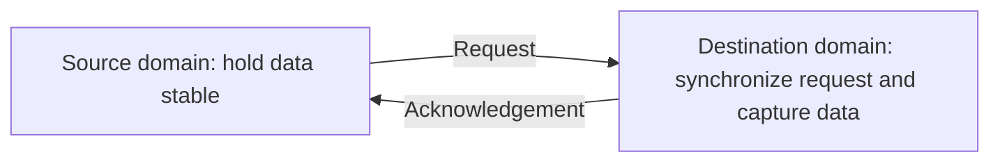
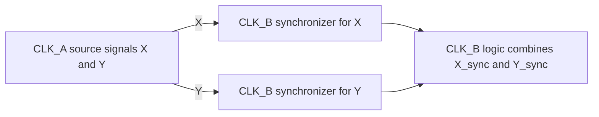

# Introduction to CDC

CDC stands for **Clock Domain Crossing**. It refers to transfer of signals or data between logic blocks operating on different clock domains. For example - block A operating in 50 MHz and block B operating in 200 MHz.

Since the source and destination blocks are operating in completely different frequencies, phases, or may be completely asynchronous, a signal that's crossing these domains can experience metastability if not handled correctly.

Metastability is a phenomenon where the register temporarily takes longer than expected to settle to a valid 0 or 1. Metastability cannot be eliminated entirely. But having a good CDC design can reduce the chance that it propagates into functional logic. 

Therefore, CDC verification is a critical part of design signoff to ensure reliable data transfer across block boundaries. 

### Example CDC Scenarios:
1. **CPU Core <-> System Bus (AXI/AHB):** The CPU core may operate at a different frequency than the system interconnect
2. **CPU Core <-> DMA Controller:** DMA engines often run on independent clocks while transferring data to or from CPU-managed memory.
3. **CPU Core <-> L2/L3 Cache:** Shared caches may operate on separate clock domains.

# CDC Verification Approaches

## Static CDC vs Dynamic CDC Analysis
### Static CDC
Static CDC - This is the most commonly used methodology
Static here means without any simulation. It is an analysis on the RTL or netlist structure without simulating the design. 

With a static CDC check we can do the following

1) Analyse the RTL/Netlist structure without doing any kind of simulation
2) Identify what are all the clock domains in the design
3) Find the crossing between the domains
4) Check if synchronizers are properly placed
5) Check if the handshake exists
6) Check for asynchronous fifo and gray counters
7) Detect convergence, data coherency, missing synchronizers and fanout issues (more on this below)

**EXAMPLE CODE:**
```bash
always @(posedege clkA)
    req <= data;

always @(posedge clkB)
    req_sync <= req;
```

Static CDC checks whether req is properly synchronized before being used in the CLKB domains

We need to use some eda tools to perform Static CDC.

### Dynamic CDC

Dynamic CDC uses simulation to exercise the design under different clock relationship conditions. It can help find protocol bugs such as:
1. Lost Requests
2. Duplicate transactions
3. Incorrect responses

Using simulation, tools check CDC behaviour. 

1. Using Dynamic CDC we simulate the clock interactions
2. Check the actual run time behaviour
3. Detect any glitches or data loss

Dynamic CDC could be performed using assertions 

**EXAMPLE ASSERTION:**
```bash
property ack_after_req;
    @(posedge clkB)
    req_sync |-> ##[1:5] ack;
endproperty
```

This checks if ack signal arrives after a synchronized request.

## 3. Common CDC structures

### Single-bit control signals

For a single bit level signal that is slowly changing, a common approach is a **two-flop synchronizer** in the destination domain:

```systemverilog
logic sync_ff1;
logic sync_ff2;

always_ff @(posedge clk_dst) begin
    sync_ff1 <= async_in;
    sync_ff2 <= sync_ff1;
end
```

The first destination-clocked flop may become metastable. The second gives it additional time to settle before the signal is used by downstream logic. 
A two-flop synchronizer is not a general solution for every crossing:

- Use it for appropriate single-bit control signals, not for each bit of an arbitrary bus.
- A short pulse may be missed if it is not sampled by the destination clock.
- Synchronizing a signal independently into multiple paths can create consistency problems if those paths are later combined.

### Pulses and event transfers

A narrow pulse can be missed by a slower destination clock. Depending on the protocol, use a pulse-stretching scheme, a toggle synchronizer, or a request/acknowledge handshake. The sender and receiver must agree on how events are represented and acknowledged.

### Multi-bit data

Passing each bit of a bus through its own two-flop synchronizer does not guarantee that all bits arrive together. The destination can capture a mixture of values from different source transactions.

Common solutions include:

- A **handshake**, where control signals coordinate when data is sent and captured. The source holds the data stable until the destination captures it and returns an acknowledgement.
- An **asynchronous FIFO**, suitable for buffered transfers between clock domains.

The right choice depends on throughput, latency, and the interface protocol.



## 4. Fan-in and fanout

- **Fan-in** is the number of inputs feeding a logic element. For example, `assign y = a & b & c;` has a fan-in of three for the AND function.
- **Fanout** is the number of loads or destinations driven by a signal. If signal `A` drives three destination pins, its fanout is three.

Fanout matters in CDC analysis because a source-domain signal that drives multiple destinations may be sampled differently by those destinations.

A particularly important case is when one asynchronous signal feeds multiple independent synchronizer chains in the same destination domain. The chains can resolve or observe the signal on different cycles. If downstream logic assumes their outputs change together, the design may behave incorrectly.

A signal synchronized separately into different destination clock domains is not automatically wrong. The risk depends on whether those independently synchronized versions must remain consistent or are later combined.

## 5. Reconvergence

**CDC reconvergence** occurs when related signals take separate CDC paths and are later combined.

For example, a source-domain value may be split into multiple signals, synchronized independently, and then recombined in destination-domain logic. Because the paths can have different timing or synchronization latency, the destination may temporarily observe a combination that never existed in the source domain.



Reconvergence is especially important when:

- Multiple bits of a related value are synchronized independently.
- Related control signals arrive through separate synchronizers.
- Independently synchronized signals are combined in downstream logic.

A handshake or asynchronous FIFO is often a better approach when a coherent multi-bit transfer is required. CDC tools can flag possible reconvergence, but the design intent and protocol still need to be reviewed.

## 6. Data coherency

**Data coherency** means that a multi-bit value observed in the destination represents one complete source-domain transaction, not a mixture of bits from different values.

For example, if a source changes a bus from `8'h3C` to `8'hA5`, the destination must not capture a combination such as `8'h25` because some bits changed before others were observed.

Common ways to preserve coherency include:

1. **Handshake:** The source presents data and uses a control protocol to indicate when it is stable and can be captured.
2. **Asynchronous FIFO:** Data and control information are transferred through a FIFO designed for independent clocks.

Do not assume that a bus is coherent just because each bit has a synchronizer.

## 7. Reset Domain Crossing (RDC)

**Reset Domain Crossing (RDC)** occurs when logic controlled by one reset domain communicates with logic controlled by another reset domain, or when reset behavior differs across interacting blocks.

RDC issues can occur even when the clocks are the same. For example, one block may come out of reset while another block it depends on is still held in reset.

Common RDC concerns include:

- Reset assertion and deassertion occurring at different times across blocks.
- Asynchronous reset deassertion near a clock edge, potentially violating recovery or removal timing.
- Logic becoming active before the blocks it depends on are ready.
- Reset signals or reset-synchronized control signals crossing between reset domains.

A common design practice is **asynchronous assertion with synchronous deassertion** for a given clock domain: reset can assert without waiting for a clock, while its release is synchronized to that domain's clock. The exact implementation should follow the project's reset architecture and library guidance.

RDC analysis checks reset relationships and reset behavior across the design. CDC and RDC are related, but they are not interchangeable: CDC focuses on clock-domain boundaries; RDC focuses on reset-domain boundaries and their interactions.

## 8. Example assertion

An assertion can check a simple request/acknowledge timing expectation in the destination clock domain:

```systemverilog
property ack_after_req;
    @(posedge clk_b)
    disable iff (!rst_b_n)
    $rose(req_sync) |-> ##[1:5] ack;
endproperty

assert property (ack_after_req);
```

This checks that `ack` is observed within one to five `clk_b` cycles after `req_sync` rises. It is only an example: real assertions should match the interface protocol, including whether requests and acknowledgements are pulses or levels, whether multiple transactions can be outstanding, and what reset behavior is expected.

## 9. Things to look out for in CDC/RDC review

- Are all clocks and generated clocks defined correctly for analysis?
- Is each crossing identified and handled with an appropriate structure?
- Are single-bit synchronizers used only for suitable signals?
- Can any pulse be missed by the destination clock?
- Are multi-bit transfers protected by a handshake or asynchronous FIFO?
- Could independent synchronizer paths reconverge?
- Are synchronizer outputs fanning out in ways that assume identical timing?
- Are reset assertion, deassertion, and sequencing safe across interacting blocks?
- Have tool findings, constraints, and waivers been reviewed and justified?
- Do simulation and assertions exercise the intended protocol behavior?
